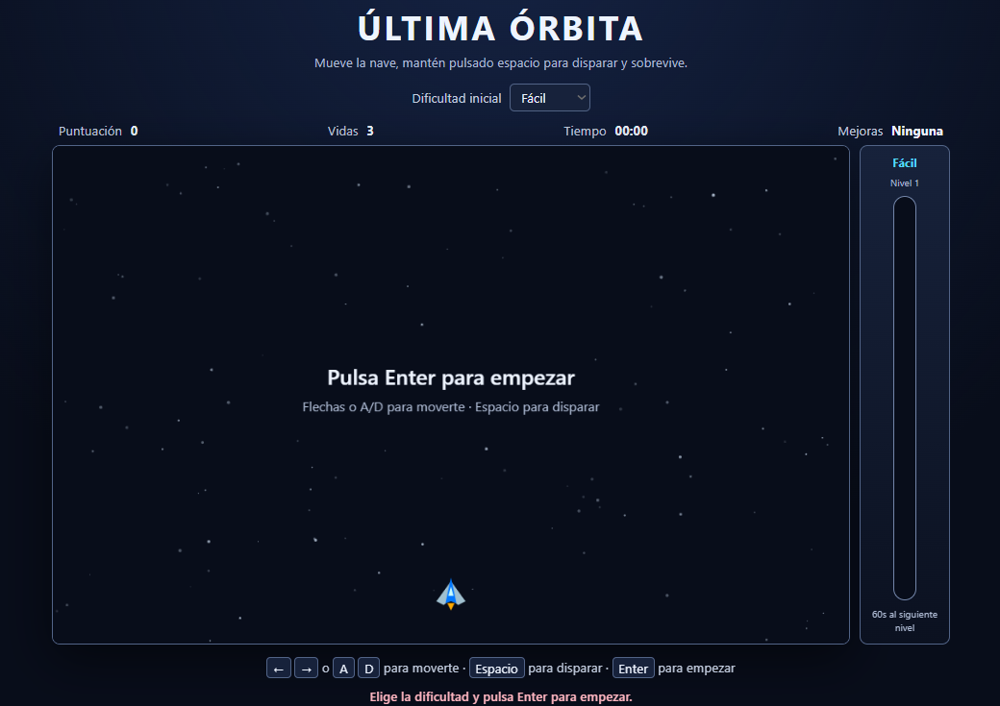
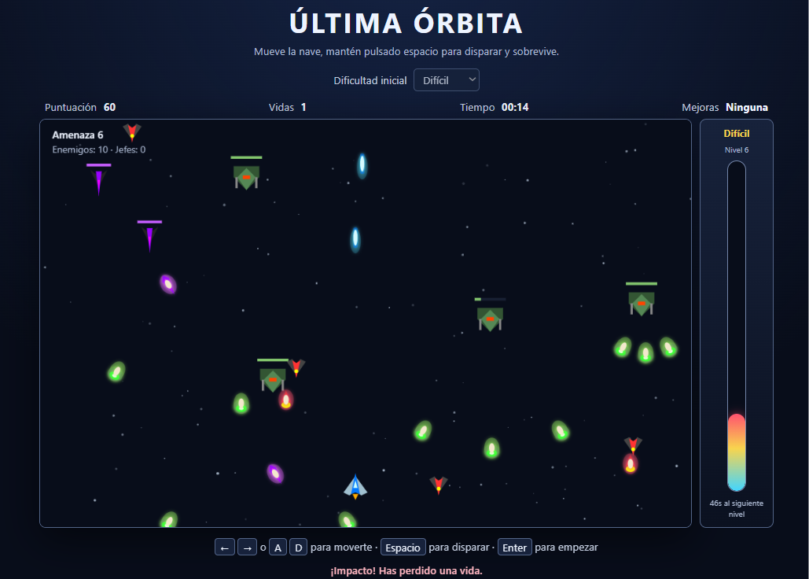

# Última Órbita — Desarrollo de Aplicación mediante SDD Asistido por IA

> **Proyecto académico**: Máster de FP en Inteligencia Artificial y Big Data (CPIFP Alan Turing, Málaga TechPark)  
> **Práctica**: Desarrollo de una aplicación mediante SDD asistido por IA  
> **Metodología estudiada e implementada**: [OpenSpec](https://github.com/Fission-AI/OpenSpec)

## 📌 1. Descripción del Proyecto

**Última Órbita** es un videojuego arcade espacial 2D desarrollado para navegador web utilizando HTML5 Canvas y JavaScript vanilla. El jugador controla una nave que debe sobrevivir a una generación continua de enemigos disparando proyectiles láser, gestionando picos de dificultad y aprovechando un sistema dinámico de mejoras por orbes.

El objetivo principal de esta práctica no es la complejidad del código generado, sino la **aplicación, gestión y supervisión de la metodología Spec-Driven Development (SDD)** con asistencia de inteligencia artificial para la definición, implementación y gestión de cambios de requisitos en el software.

<table>
  <tr>
    <td align="center" style="padding-bottom: 15px;"><strong>Pantalla inicial</strong></td>
    <td align="center" style="padding-bottom: 15px;"><strong>Partida en ejecución</strong></td>
  </tr>
  <tr>
    <td align="center">
      
    </td>
    <td align="center">
      
    </td>
  </tr>
</table>

## 🛠️ 2. Tecnologías y Herramientas

* **Lenguajes y cliente**: HTML5, CSS3, JavaScript, HTML5 Canvas, Vectores SVG.
* **Metodología SDD**: OpenSpec.
* **Control de versiones**: Git y GitHub.
* **Entorno**: Aplicación estática ejecutable sin frameworks ni dependencias externas.

## 🚀 3. Instrucciones de Ejecución

La aplicación es estática y no requiere instalación de dependencias ni gestores de paquetes.

### Opción 1: Abrir directamente el archivo

1. Clona el repositorio o descarga el proyecto.
2. Abre el archivo [`index.html`](./index.html) directamente con cualquier navegador web moderno (Chrome, Firefox, Edge, Safari).

### Opción 2: Servidor HTTP local (Recomendado)

Para evitar posibles restricciones de políticas locales en la carga de recursos SVG en algunos navegadores, se recomienda iniciar un servidor HTTP básico:

```bash
# Con Python 3
python -m http.server 8000

# Con Node.js (opcional)
npx serve .
```

A continuación, accede a `http://localhost:8000` en tu navegador.

## 🎮 4. Mecánicas del Juego y Funcionalidades

### 4.1 Funcionalidades base del MVP

* Pantalla de inicio y Game Over con reinicio de partida.

* Movimiento horizontal de la nave dentro de los límites de la pantalla.

* Sistema de disparos mediante proyectiles láser.

* Generación de enemigos con patrones de movimiento y dificultad progresiva.

* Detección de colisiones (láser-enemigo y enemigo-nave).

* Sistema de vidas y marcador de puntuación en tiempo real.

El MVP inicial se definió con oleadas finitas. Después de completarlo se gestionó un
cambio de requisitos mediante OpenSpec para convertir el juego en una experiencia de
supervivencia infinita. La versión actual del código corresponde a esa evolución e
incluye generación continua, bosses, proyectiles enemigos y mejoras.

### 4.2 Sistema de Dificultad y HUD

La dificultad escala dinámicamente según el tiempo efectivo de amenaza. Los modos de inicio ajustan el punto de partida temporal: **Fácil** empieza en $t = 0\text{ min}$, **Normal** en $t = 2:30\text{ min}$ y **Difícil** en $t = 5:00\text{ min}$ (por lo que alcanzar el minuto 5 en Fácil equivale a comenzar en Difícil).

El HUD incluye una **barra vertical a la derecha** que refleja de forma visual el nivel de amenaza y el progreso hacia el siguiente minuto.

| Amenaza efectiva | Estado | Impacto en Gameplay |
| :--- | :--- | :--- |
| $0\text{ a } <2\text{ min}$ | **Fácil** | Tasa de reaparición baja y patrones sencillos. |
| $2\text{ a } <5\text{ min}$ | **Normal** | Incremento de densidad enemiga. |
| $5\text{ a } <10\text{ min}$ | **Difícil** | Mayor velocidad y disparos frecuentes. |
| $10\text{ a } <15\text{ min}$ | **Muy difícil** | Picos de generación intensos. |
| $15\text{ a } <20\text{ min}$ | **Imposible** | Presión enemiga constante. |
| $\ge 20\text{ min}$ | **¡JA, JA, JA…!** | Sobrevivencia extrema. |

> *Nota de diseño*: El generador de enemigos incluye un algoritmo de equidad para evitar crear situaciones injustas o colisiones inevitables al no generar enemigos directamente sobre la posición actual de la nave.

### 4.3 Combate, Jefes y Mejoras (Orbes)

* **Enemigos y Proyectiles**:
  * Tres tipos de enemigos estándar con sprites, resistencia, patrones de movimiento y proyectiles específicos.
  * Disparos diagonales que rotan según su trayectoria hacia abajo.
  * Todos los proyectiles cuentan con efectos de brillo para mayor legibilidad.
  * **Anulación de disparos**: Los proyectiles del jugador pueden colisionar con las balas enemigas, destruyendo ambas sin otorgar puntos.
* **Jefes (Boss) y Apoyo**:
  * Cada minuto real de juego aparece un Boss acompañado de escolta.
  * **Láser de apoyo**: Se activa tras una fijación de objetivo en un punto fijo. El láser viaja hasta ese punto y destruye a todos los enemigos a su paso, independientemente del movimiento de la nave.
* **Sistema de Orbes de Mejoras**:
  * Se intenta generar un orbe aleatorio cada $30\text{ segundos}$ de partida.
  * Destacan visualmente con un halo de color, un aro pulsante y destellos.
  * **Tipos de Orbe**:
    * 🛡️ **Escudo**: Bloquea un impacto directo.
    * ❤️ **Vida**: Recupera un punto de salud (máximo 3).
    * ⚡ **Aceleración**: Aumenta la velocidad temporalmente durante $15\text{ segundos}$.
    * 🔫 **Disparo adicional**: Añade líneas de tiro acumulativas durante la partida.
    * 🎯 **Perforación**: Disparos que atraviesan múltiples objetivos.
    * 🪭 **Abanico**: Cobertura de disparo en ángulo amplio.

### 4.4 Recursos gráficos

El juego emplea vectores SVG locales almacenados en la carpeta `assets/`:
* Nave principal, 3 tipos de enemigos, boss y proyectiles.
* 6 variedades de orbes: escudo, vida, disparo adicional, aceleración, perforación y abanico.
* Efectos visuales de renderizado en Canvas: halos tenues en orbes y brillo moderado en proyectiles.
* **Sistema de reserva (Fallback)**: Si algún archivo SVG no se puede cargar correctamente, el motor gráfico dibuja un indicador visual alternativo.

### 4.5 Controles del Juego

| Tecla | Acción |
| :--- | :--- |
| `←` / `A` | Mover la nave hacia la izquierda |
| `→` / `D` | Mover la nave hacia la derecha |
| `Espacio` | Disparar láseres |
| `Enter` | Iniciar / Reiniciar la partida |

## ⚙️ 5. Aplicación de la Metodología SDD (OpenSpec)

El desarrollo del Producto Mínimo Viable (MVP) y sus posteriores iteraciones se articularon a través de la herramienta **OpenSpec**.

```text
Requisitos iniciales
        │
        ▼
Proposal (Propuesta) ──► Design (Diseño técnico) ──► Specs (Escenarios)
                                                           │
                                                           ▼
Verificación ◄── Implementación ◄── Tasks (Descomposición)
```

### Artefactos principales empleados:

* [Propuesta del MVP](./openspec/changes/archive/2026-10-27-ultima-orbita-mvp/proposal.md): Justificación, alcance e impacto del cambio inicial.
* [Diseño del MVP](./openspec/changes/archive/2026-10-27-ultima-orbita-mvp/design.md): Decisiones técnicas de renderizado Canvas y estructuras de datos.
* [Tareas del MVP](./openspec/changes/archive/2026-10-27-ultima-orbita-mvp/tasks.md): Desglose de tareas de implementación.
* [Especificación del MVP](./openspec/changes/archive/2026-10-27-ultima-orbita-mvp/specs/arcade-gameplay/spec.md): Requisitos iniciales y criterios de aceptación.
* [Propuesta de supervivencia infinita](./openspec/changes/archive/2026-10-27-ultima-orbita-infinite-survival/proposal.md): Cambio de requisitos posterior al MVP.
* [Diseño de supervivencia infinita](./openspec/changes/archive/2026-10-27-ultima-orbita-infinite-survival/design.md): Decisiones técnicas del cambio.
* [Tareas de supervivencia infinita](./openspec/changes/archive/2026-10-27-ultima-orbita-infinite-survival/tasks.md): Trabajo realizado para implementar el cambio.
* [Especificación actual](./openspec/specs/arcade-gameplay/spec.md): Contrato funcional vigente del juego.

## 🔄 6. Gestión del Cambio de Requisitos

Tal y como establece el enunciado de la práctica, tras completar el MVP funcional se introdujo una modificación en los requisitos del proyecto (sistema avanzado de orbes y comportamiento de jefes). En lugar de modificar el código de forma directa, el cambio se gestionó formalmente aplicando el flujo SDD:

1. **Análisis del nuevo requisito**: Evaluación del impacto en los componentes del motor de colisiones y renderizado.
2. **Propuesta OpenSpec**: Creación de un nuevo cambio en la ruta `openspec/changes/`.
3. **Actualización de la especificación**: Definición del diseño técnico de orbes, escenarios de comportamiento y tareas asociadas.
4. **Implementación asistida por IA**: Modificación del código fuente guiada por las nuevas especificaciones.
5. **Verificación y sincronización**: Comprobación de criterios de aceptación y actualización de la especificación principal.

## 📂 7. Estructura del Repositorio

```text
.
├── index.html              # Interfaz HTML y lienzo Canvas
├── styles.css              # Estilos visuales de la aplicación y HUD
├── game.js                 # Lógica principal del videojuego
├── briefing.md             # Briefing inicial del proyecto
├── PRD.md                  # Product Requirements Document
├── README.md               # Documentación general del repositorio
├── presentacion.pdf        # Diapositivas empleadas en la exposición oral
├── screenshots/            # Capturas de la aplicación funcionando
├── openspec/               # Configuración y artefactos de la metodología OpenSpec
│   ├── config.yaml
│   ├── changes/            # Registro de cambios (MVP e iteraciones)
│   └── specs/              # Especificación principal sincronizada
└── assets/                 # Recursos gráficos SVG
    ├── player.svg
    ├── boss1.svg
    ├── enemigo1.svg, enemigo2.svg, enemigo3.svg
    ├── disparo-jugador.svg
    ├── disparo-enemigo1.svg, disparo-enemigo2.svg, disparo-enemigo3.svg
    ├── disparo-boss1.svg
    └── escudo.svg, heal.svg, +1disparo.svg, aceleracion.svg, perforante.svg, abanico.svg
```

## 📢 8. Presentación y documentación

* **Presentación para la exposición oral**: [presentacion.pdf](./presentacion.pdf).

* **Documentación de diseño**:
  * [Briefing inicial](./briefing.md)
  * [Product Requirements Document (PRD)](./PRD.md)
  * [Instrucciones de la práctica](./instrucciones.txt)
  * [Especificación actual de OpenSpec](./openspec/specs/arcade-gameplay/spec.md)


## 📚 9. Bibliografía y Recursos

* **Metodología y Herramientas SDD**:
  * [OpenSpec en GitHub](https://github.com/Fission-AI/OpenSpec) — Repositorio y documentación oficial del marco de trabajo.
* **Desarrollo Web y Gráficos Canvas / SVG**:
  * [MDN Web Docs: Canvas API](https://developer.mozilla.org/es/docs/Web/API/Canvas_API) — Guía para el renderizado 2D en navegador.
  * [MDN Web Docs: SVG en Canvas](https://developer.mozilla.org/en-US/docs/Web/API/CanvasRenderingContext2D/drawImage) — Carga y renderizado de imágenes vectoriales.
  * [MDN Web Docs: requestAnimationFrame](https://developer.mozilla.org/es/docs/Web/API/Window/requestAnimationFrame) — Optimización del ciclo del juego (*game loop*).

## 👥 10. Equipo de Desarrollo

* **Integrante 1** — [@elenahermososilva-cyber](https://github.com/elenahermososilva-cyber)
* **Integrante 2** — [@roomeroo](https://github.com/roomeroo)
* **Integrante 3** — [@escastel](https://github.com/escastel)
